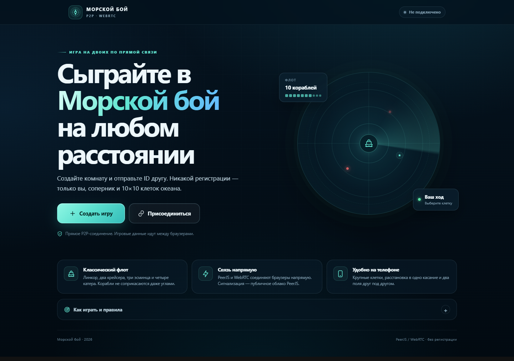
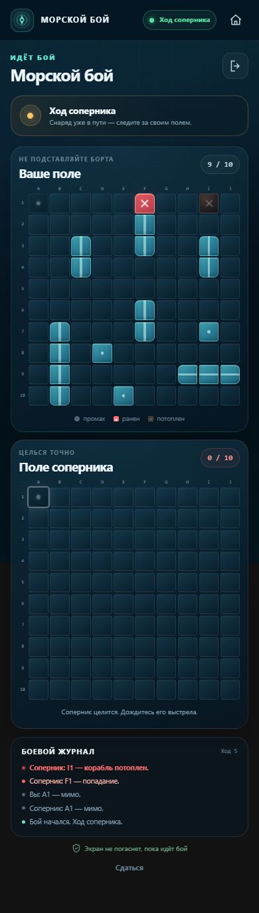
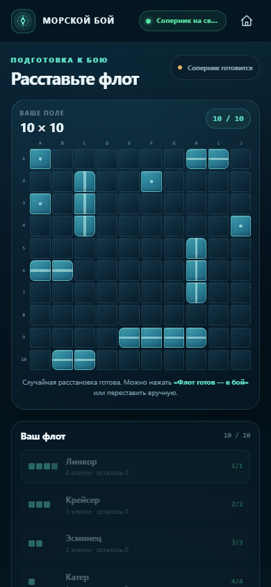

# Морской бой — P2P на PeerJS

Полностью клиентское веб-приложение для игры в «Морской бой» на двоих. Игроки
создают комнату, обмениваются ID и играют через прямое WebRTC-соединение —
без регистрации, базы данных и игрового сервера.



| Партия на телефоне | Расстановка флота |
| --- | --- |
|  |  |

## Что реализовано

- классический флот: линкор, 2 крейсера, 3 эсминца, 4 катера;
- проверка расстановки: корабли не выходят за поле, не пересекаются и не
  касаются друг друга даже углами;
- расстановка в одно касание, поворот корабля, случайная расстановка, отмена
  последнего корабля и очистка поля;
- на широком экране поле соперника стоит рядом со своим, на телефоне и
  планшете поля перестраиваются в колонку;
- выстрелы по касанию, промах, попадание, потопление и автоматическое
  завершение партии;
- раненые и потопленные клетки различаются: раненый корабль остаётся ярко-красным
  с крестом, а потопленный становится тусклым и выгоревшим;
- Screen Wake Lock удерживает экран телефона включённым во время расстановки и
  боя, чтобы партия не обрывалась при автоблокировке;
- передача хода после промаха и продолжение хода после попадания;
- готовность обоих игроков до старта боя;
- копирование ID, копирование ссылки, вставка из буфера и системное «Поделиться»;
- реванш, сдача, выход в лобби и обработка обрыва связи;
- адаптивная вёрстка для Android/iOS, крупные клетки и кнопки;
- доступные подписи клеток, статус хода, `aria-live`-уведомления и модальные окна.

## Быстрый запуск

Приложению не нужен сборщик. В проекте есть маленький статический сервер без
зависимостей:

```bash
npm start
```

Откройте `http://localhost:8080`. Для игры на двух устройствах нужен **HTTPS**:
браузеры разрешают WebRTC на внешних адресах только в защищённом контексте.
`localhost` — исключение.

Самый простой способ проверить с телефона — выложить папку как статический сайт:

- **Netlify Drop** — перетащить папку проекта в браузер;
- **GitHub Pages** — опубликовать содержимое репозитория;
- **Cloudflare Pages / Vercel** — выбрать «static site», без команды сборки.

После публикации оба игрока открывают один и тот же HTTPS-адрес. Один нажимает
«Создать игру», второй — «Присоединиться» и вставляет ID или ссылку.

Пошаговая инструкция для новичка — в отдельном файле:
[«Публикация игры на GitHub Pages»](docs/GITHUB_PAGES.md).

> Не открывайте игру через `file://`: в этом режиме буфер обмена, WebRTC и
> некоторые браузерные ограничения работают непредсказуемо. Приложение
> предупредит об этом.

## Как играть

1. Создайте комнату и отправьте другу ID или ссылку.
2. Расставьте 10 кораблей на своём поле. Выберите тип корабля, при
   необходимости поверните его кнопкой «Горизонтально / Вертикально» (или
   клавишей `R`) и коснитесь клетки. Можно нажать «Случайно».
3. Когда оба игрока нажмут «Флот готов — в бой», начнётся партия. Первым ходит
   создатель комнаты.
4. Касайтесь клеток на поле соперника. Промах передаёт ход, попадание
   оставляет ход у стрелявшего. Раненый корабль подсвечивается красным, а
   потопленный тускнеет — по этому видно, куда стрелять дальше.
5. Побеждает тот, кто первым потопит все 10 кораблей соперника.

## Сетевая архитектура

```
Браузер A ── PeerJS DataConnection (WebRTC, напрямую) ── Браузер B
     │                                                       │
     └──────────── сигнальный сервер PeerJS ────────────────┘
                    (только рукопожатие)
```

- **Библиотека:** PeerJS 1.5.5, файл `vendor/peerjs.min.js` лежит локально.
- **Данные:** после открытия `DataConnection` сообщения передаются через
  `conn.send()` и принимаются в `conn.on('data')`; игровой трафик не проходит
  через сигнальный сервер.
- **Надёжность канала:** `reliable: true`, JSON-сериализация.
- **Сигнализация:** по умолчанию используется публичное облако PeerJS
  (`0.peerjs.com`, порт 443) — как требует сценарий проекта.

### Резервная сигнализация

В некоторых сетях, в частности в России, Cloudflare отвечает `403` на
`0.peerjs.com` ([подтверждение в документации сообщества](https://github.com/xfenix/slidemachina/blob/038dddaa2db4ce9d2afa1b70f54536807632e0c0/remote-cloudflare/README.md)).
Чтобы приложение оставалось работоспособным, хост сначала пробует облако
PeerJS, а при сетевой ошибке автоматически переходит на публичные
PeerJS-совместимые серверы:

1. `0.peerjs.com` — штатное облако PeerJS;
2. `xfenix.ru` — публичный PeerJS-сервер;
3. `slidemachina-broker.xfenix.workers.dev` — публичный резервный брокер.

Выбранный сервер кодируется в ID комнаты:

```
bsb-c-a1b2c3d4   → облако PeerJS
bsb-x-a1b2c3d4   → xfenix.ru
bsb-w-a1b2c3d4   → резервный брокер
```

Благодаря этому второй игрок автоматически подключается к тому же серверу,
даже если ему передали только ID. Резервные серверы — сторонние публичные
сервисы без гарантий доступности; для продакшена надёжнее поднять свой
PeerServer и заменить список `SIGNALING_SERVERS` в начале `js/app.js`. Инструкция:
[PeerJS Server — Getting Started](https://peerjs.com/server/getting-started).

## Протокол обмена

Все сообщения содержат `v: 1` и `type`:

| Тип | Назначение |
| --- | --- |
| `hello` | рукопожатие, роль игрока |
| `ready` | готовая расстановка (`layout`) |
| `shot` | выстрел по координатам `x`, `y` |
| `shot-result` | ответ владельца поля: `miss`, `hit`, `sunk` или `invalid` |
| `resign` | сдача |
| `rematch-request` / `rematch-accept` / `rematch-decline` | реванш |
| `leave` | выход из комнаты |

### Синхронизация состояния

- Каждый клиент хранит **своё** поле и **свою** историю полученных выстрелов.
- При готовности игрок отправляет только расстановку. Соперник валидирует её
  тем же движком, что и локальную, и строит копию поля.
- Стрелявший не может сам решить, попал ли он: владелец поля обрабатывает
  выстрел движком и отправляет результат.
- После ответа оба клиента независимо обновляют ход по одному правилу:
  `myTurn = (result !== 'miss')` у стрелявшего и `myTurn = (result === 'miss')`
  у защищающегося.
- Потопленный корабль передаётся списком клеток, чтобы обе стороны закрасили
  его одинаково.
- При обрыве ICE-соединения дополнительный watchdog проверяет
  `RTCPeerConnection.connectionState` и останавливает партию, даже если PeerJS
  не прислал событие `close`.
- Во время расстановки и боя приложение запрашивает Screen Wake Lock, а при
  возврате на вкладку — восстанавливает его. Если браузер блокировку не
  поддерживает или отклонил запрос, в подвале игрового экрана появляется
  подсказка отключить автоблокировку вручную.

## Структура проекта

```
index.html              разметка всех экранов и SVG-иконки
css/styles.css          адаптивная тёмная тема, доска, анимации
js/engine.js            чистый игровой движок (браузер + Node.js)
js/app.js               UI, PeerJS, протокол, расстановка, игровой поток
vendor/peerjs.min.js    PeerJS 1.5.5
vendor/peerjs.LICENSE   лицензия PeerJS
server.mjs              локальный статический сервер без зависимостей
tests/engine.test.mjs   юнит-тесты движка
tests/e2e.mjs           реальная партия в двух браузерах
assets/favicon.svg      иконка
docs/screenshots/       скриншоты для README
```

## Тесты

```bash
npm test
```

Проверяет флот, запрет касаний, валидацию расстановки, промахи, попадания,
потопление, победу, применение результата на чужом поле и случайную генерацию.

E2E-тест запускает два изолированных браузерных контекста, создаёт настоящую
комнату через PeerJS, подключается вторым игроком, расставляет флоты, проверяет
передачу хода, топит весь флот, играет реванш, сдаётся, проверяет выход соперника
и валидацию ID.

```bash
npm install          # только для E2E: playwright-core
npm start            # терминал 1
npm run test:e2e     # терминал 2
```

Нужен установленный Chrome. При необходимости укажите путь:

```powershell
$env:CHROME_PATH = "C:\Program Files\Google\Chrome\Application\chrome.exe"
npm run test:e2e
```

E2E использует реальную публичную сигнализацию и WebRTC, поэтому занимает
около минуты и требует интернета. Скриншоты теста сохраняются в
`test-artifacts/` (папка исключена из git).

## Обработка ошибок

- некорректный ID, пустая комната, занятый ID;
- недоступное облако PeerJS → автоматический переход на резервный сервер;
- ошибка WebRTC, отсутствие поддержки браузера;
- таймауты создания комнаты и подключения;
- отказ соперника от реванша;
- штатный выход и обрыв прямого канала;
- проверка формата расстановки и координат, защита от повторных выстрелов;
- таймаут ожидания прямого канала и watchdog ICE-состояния.

## Переиспользуемый skill про P2P

Механизм связи, собранный в этом приложении, вынесен в отдельный skill для
DeepSeek Harness: `peerjs-p2p-rooms`.

- В репозитории: [`docs/skill/peerjs-p2p-rooms`](docs/skill/peerjs-p2p-rooms/SKILL.md).
- Установленная копия: `C:\Users\dondi\.dsh\skills\peerjs-p2p-rooms`.

Skill описывает повторяемый рецепт: резервную сигнализацию с ключом сервера
внутри кода комнаты, жизненный цикл соединения, версионированный протокол,
схему «владелец состояния отвечает за результат», watchdog ICE-состояния,
Screen Wake Lock и проверку двумя браузерами через Playwright. В папке
`references/` лежат готовый модуль `peerjs-session.js` и шаблон
`e2e-two-browsers.mjs`. Модуль проверен реальным рукопожатием двух браузеров:
`ping`/`pong` доставляются, комната автоматически поднимается на резервном
сигнальном сервере.

Использование в новом проекте: попросите агента «используй skill
peerjs-p2p-rooms» — он загрузится в контекст, после чего достаточно скопировать
`references/peerjs-session.js` в проект и подключить PeerJS.

Локальная копия в репозитории — для совместного доступа и истории; при правках
обновляйте обе (или переустановите из репозитория).

## Ограничения

- Комната живёт, пока открыта вкладка создателя. Обновление страницы
  завершает партию — сохранения и переподключения нет.
- P2P-логика полностью на клиенте. Это пет-проект, а не античит: при желании
  игрок может изменить код браузера.
- Нет собственного TURN-сервера. В редких сетях с симметричным NAT прямое
  соединение может не установиться; браузеры попробуют STUN, но не relay.
- Screen Wake Lock поддерживают Chrome/Edge на Android, Safari 16.4+ на iOS и
  современные десктопные браузеры. В старом Safari и во встроенных браузерах
  мессенджеров блокировка может не работать — тогда экран придётся дольше
  не гасить вручную.
- Публичные сигнальные серверы видят IP-адреса участников и ID комнаты, но не
  игровые выстрелы. Резервные серверы — сторонние сервисы без SLA.
- Звука нет — только визуальные и тактильные (на поддерживаемых устройствах)
  эффекты.

## Лицензия

Код проекта — MIT (`LICENSE`). PeerJS распространяется по лицензии MIT,
текст находится в `vendor/peerjs.LICENSE`.
